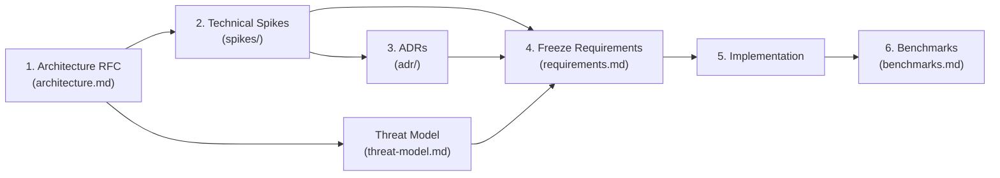

# Graft Documentation Hub

Welcome to the engineering documentation for **Graft**. This directory captures the system architecture, pre-implementation research spikes, architectural decisions, requirements, threat model, and evaluation benchmarks.

## Pre-Implementation Workflow

Before writing production code, Graft follows an incremental validation flow so requirements and core interfaces are grounded in verified constraints:

## Documentation Index

| Document | Purpose | Current Status | Link |
| :--- | :--- | :--- | :--- |
| Architecture RFC-001 | System scope, component topology, job state machine, sequence flow, and open questions | `Draft (In Research)` | [architecture.md](./architecture.md) |
| Technical Spikes Index | Tracking log and workflow for timeboxed PoCs (`001`–`003`) | `2 Completed, 1 Pending` | [spikes/README.md](./spikes/README.md) |
| Spike Learnings | Consolidated empirical findings and takeaways across spikes | `In Progress (2/3 Spikes Completed)` | [spikes/learnings.md](./spikes/learnings.md) |
| ADR Index | Log of architectural decisions (`001`–`005`) and status lifecycle | `4 Accepted, 1 Proposed` | [adr/README.md](./adr/README.md) |
| Requirements | Functional (`FR`) and non-functional (`NFR`) specification frozen after spikes | `Template (Pending Evidence)` | [requirements.md](./requirements.md) |
| Threat Model | Trust boundaries, threat matrix, guardrails, and open security questions | `Template (Pending Evidence)` | [threat-model.md](./threat-model.md) |
| Benchmarks | Mini SWE-bench metrics, dataset spec, and local vs. cloud comparison tables | `Template (Pending Evidence)` | [benchmarks.md](./benchmarks.md) |

## Maintenance Rules

1. **Starting a New Spike:**
   - Copy [spikes/template.md](./spikes/template.md) to `docs/spikes/NNN-short-slug.md`.
   - Register it in [spikes/README.md](./spikes/README.md) with status `Pending` or `In Progress`.
   - Once completed, record `Result`, `Key Learnings`, and `Impact on Requirements & ADRs`, synthesize takeaways in [spikes/learnings.md](./spikes/learnings.md), and update the relevant ADR(s) and `requirements.md`.
2. **Recording an Architectural Decision (ADR):**
   - Copy [adr/template.md](./adr/template.md) to `docs/adr/NNN-short-slug.md`.
   - Register it in [adr/README.md](./adr/README.md) with status `Proposed`.
   - Promote an ADR to `Accepted` once its blocking Spike (if any) is completed and the trade-offs are validated.
   - Never delete an accepted ADR when a design changes; add a new ADR and mark the previous one `Superseded`.
3. **Freezing Requirements:**
   - Do not mark [requirements.md](./requirements.md) as `Frozen` / `Accepted` until Spikes `001`–`003` are resolved and open items in [threat-model.md](./threat-model.md) have concrete mitigations.
4. **Keeping Diagrams & Contracts Synced:**
   - Whenever an API endpoint, Redis key, or state transition changes, update [architecture.md](./architecture.md) alongside the affected ADR or requirement.
