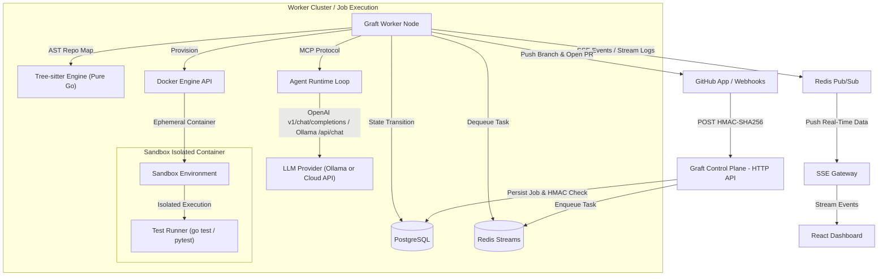
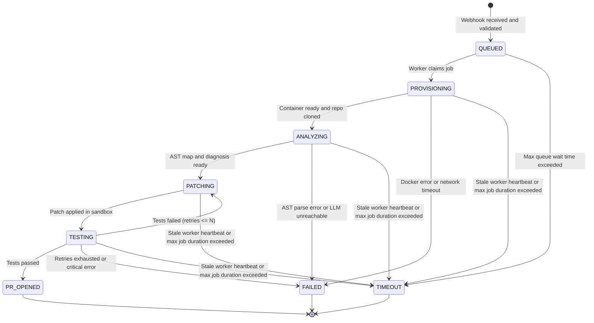
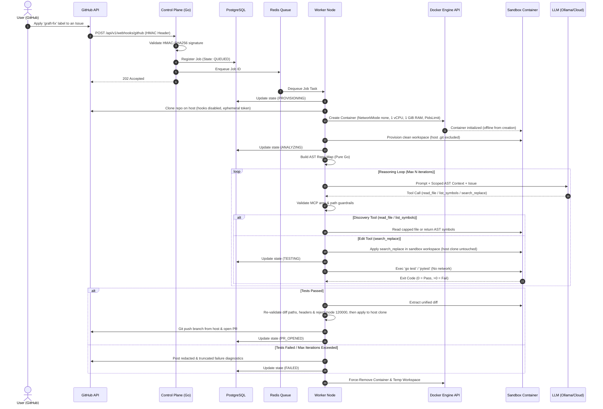

# RFC-001: Graft Architecture

| Field | Value |
| :--- | :--- |
| **System** | Graft — AI Agent Orchestrator for GitHub in Isolated Sandboxes |
| **Status** | `Accepted (Phase 0 Baseline)` |
| **Author** | `HaroldHF` |
| **Date** | `2026-11-25` |

---

## 1. Problem and Objective

### 1.1 Context

Automated issue resolution using Large Language Models (LLMs) introduces two major risks when executed without adequate isolation and control:

- **Security Risks:** Running arbitrary LLM-generated code or scripts directly on the host machine can lead to secret exfiltration or malicious execution (e.g., via Prompt Injection).
- **Lack of Determinism and Visibility:** Many agent frameworks operate as opaque black boxes without transactional state persistence or step-by-step auditability.

### 1.2 Purpose of Graft

**Graft** is a distributed platform written in Go that automates the code-patching lifecycle triggered by GitHub events (such as issue labeling or CI failures). It executes every task inside an ephemeral container provisioned via the Docker Engine API, isolating network access and compute resources. Candidate patches are validated against local unit tests before opening a verified Pull Request.

### 1.3 Scope

#### In-Scope

- Idempotent ingestion of webhooks signed by GitHub Apps (`HMAC-SHA256`).
- Persistent job state machine in PostgreSQL paired with a Redis task queue.
- Sandbox manager in Go using the Docker Engine API directly (network isolation, CPU/RAM/PID limits, and ephemeral volumes).
- Provider-agnostic autonomous agent engine (supporting cloud OpenAI-compatible `v1/chat/completions` APIs and local Ollama `/api/chat` via a unified Go `LLMClient` interface).
- Repository indexing via AST parsing with Tree-sitter and structured tool exposure via the Model Context Protocol (MCP).
- Real-time log and telemetry streaming to a web dashboard via Server-Sent Events (SSE).
- Benchmark evaluation suite (mini SWE-bench) to measure `Pass@1`, latency, and token usage.

#### Out-of-Scope

- Training or fine-tuning language models.
- Multi-cluster Kubernetes orchestration (focused instead on a high-performance Docker runtime).
- Real-time multi-user collaborative editing inside the sandbox.

---

## 2. High-Level Architecture

The system is structured as a modular monolith in Go decoupled by events and task queues.

---

## 3. Components and Responsibilities

| Component | Technology | Primary Responsibility | Interface / Contract |
| :--- | :--- | :--- | :--- |
| **Control Plane API** | Go (`chi`) | Webhook reception, HMAC signature verification, idempotency control, and job status queries | `HTTP POST /api/v1/webhooks/github` |
| **Persistence** | PostgreSQL (`sqlc`) | Persist job state machine, step-by-step history (audit trail), and repository configurations | SQL tables + `JSONB` columns |
| **Job Queue & Bus** | Redis | Decouple asynchronous tasks between API and Workers, plus a Pub/Sub channel for live events | Redis Streams (`graft:jobs`) & Pub/Sub (`graft:telemetry`) |
| **Sandbox Manager** | Go + Docker SDK | Full container lifecycle: creation, clean workspace provisioning, `NetworkMode: "none"` isolation, cgroup limits, and forced teardown | Go interface `SandboxManager` |
| **AST Indexer** | Tree-sitter (Pure Go — `gotreesitter`) | Generate syntactic repository maps to reduce prompt context window usage | Go interface `ASTIndexer` / In-memory Repository Map |
| **Agent Runtime** | Go + MCP | Reasoning loop (Plan & Execute), tool-call validation, and security guardrails | MCP JSON-RPC Client/Server |
| **SSE Gateway** | Go | Relay container and LLM logs in real time to the frontend | `HTTP GET /api/v1/jobs/{id}/stream` |
| **Dashboard** | React + TS + Tailwind | Display current job status, `git diff` viewer, and live sandbox console | SPA consuming SSE & REST APIs |

---

## 4. Job State Machine

Each **Job** represents the resolution attempt for a specific issue. State transitions are deterministic and persisted transactionally in PostgreSQL.

### Transition and Recovery Rules

- **Idempotency & Trigger Authorization:** If a webhook arrives with an `X-GitHub-Delivery` UUID that has already been processed or is currently running, the system ignores the duplicate request. Failed `workflow_run` events originating from external forks (`head_repository.id != base_repository.id`) are rejected before job creation.
- **Worker Heartbeat, Reaper & Job Timeout:** Active workers update `last_heartbeat_at` periodically (`~30s`). If a worker crashes or disconnects, a background **reaper** detects jobs in any non-terminal execution state (`PROVISIONING`, `ANALYZING`, `PATCHING`, `TESTING`) whose heartbeat is stale (`> 2 minutes`), force-removes orphaned containers by UUID, and either re-enqueues the job (`attempt_count <= 2`) or transitions it to `TIMEOUT`. Separately, each job enforces a configurable wall-clock `max_job_timeout` (`10 minutes` default for cloud providers; `20 minutes` default for local Ollama `14B`).
- **Retry Limit:** The `TESTING -> PATCHING` transition allows at most `N = 5` iterations (`N = 3` default for local `14B` runs); once exceeded, the job transitions to `FAILED`.

---

## 5. Sequence Diagram (Main Flow)

> [!NOTE]
> **Sandbox Isolation Decided ([ADR-002](./adr/002-docker-sdk-sandbox.md) `Accepted`):** Per [Spike 001](./spikes/001-docker-network-isolation.md), sandboxes always start with `NetworkMode: "none"` and never receive GitHub credentials or writable host `.git/` directories; `git clone` and `git push` run exclusively on the worker host. See [Threat Model](./threat-model.md).

---

## 6. Open Questions and Uncertainties (Spike Inputs)

All Phase 0 technical spikes (`001`–`003`) are complete, core ADRs (`001`–`005`) are **Accepted**, [threat-model.md](./threat-model.md) is **Accepted (Phase 0 Verified)**, and [requirements.md](./requirements.md) is **Frozen (Phase 0 Baseline)** from [learnings.md](./spikes/learnings.md):

> [!NOTE]
> **Resolved Pre-Implementation Decisions:**
> - **Docker SDK & Network Isolation:** Decided in [ADR-002](./adr/002-docker-sdk-sandbox.md) (`Accepted`) via [Spike 001](./spikes/001-docker-network-isolation.md) — `github.com/moby/moby/client`, `NetworkMode: "none"` from creation, host-side Git with isolated host `.git/`, abstracted workspace transport, and mandatory forced `ContainerRemove` on timeout.
> - **Tree-sitter Go Bindings, Go Monolith Packaging & MCP Tool Guardrails:** Decided in [ADR-003](./adr/003-treesitter-and-mcp.md) and [ADR-001](./adr/001-go-control-plane.md) (`Accepted`) via [Spike 002](./spikes/002-treesitter-go-bindings.md) and [Spike 003](./spikes/003-ollama-tool-calling.md) — pure-Go `gotreesitter` (`CGO_ENABLED=0` runtime builds) behind `ASTIndexer` enforcing pre-parse per-file size caps and worker concurrency limits, Repo Map token-budget scoping, `search_replace` applied in the sandbox workspace before post-test host diff extraction, and deterministic MCP JSON-RPC validation (`256 KiB` cap, `.github/` read-only vs. write-blocked split, diff-header + Git mode `120000` checks, and per-segment `os.Lstat` + `os.Readlink` + `EvalSymlinks` containment).
> - **LLM Provider Abstraction & Local Runtime Boundaries:** Decided in [ADR-004](./adr/004-llm-provider-abstraction.md) (`Accepted`) via [Spike 003](./spikes/003-ollama-tool-calling.md) — unified `LLMClient` interface over cloud `v1/chat/completions` (design-adopted pending Phase 4 benchmarks) and Ollama `/api/chat` (`options.num_ctx`), with pre-request token-estimate vs. `prompt_eval_count` truncation auditing, multi-stage `content` JSON fallback + control-char sanitizer, single-tool-per-turn / non-oracle 1-turn prompt-repair retry, and localized single-file scoping for local `7B`/`14B` models.
> - **GitHub App Installation Token Caching:** Decided in [ADR-005](./adr/005-github-app-token-manager.md) (`Accepted`) — minting and refreshing 1-hour Installation Access Tokens uses a per-worker in-memory `TokenManager` with `singleflight` deduplication (validated directly via Phase 1 `go test -race` unit tests rather than a disposable spike).

---

## 7. Related Documents

- [Documentation Hub](./README.md)
- [Technical Spikes](./spikes/README.md)
- [Architecture Decision Records (ADRs)](./adr/README.md)
- [Requirements](./requirements.md)
- [Threat Model](./threat-model.md)
- [Benchmarks](./benchmarks.md)
