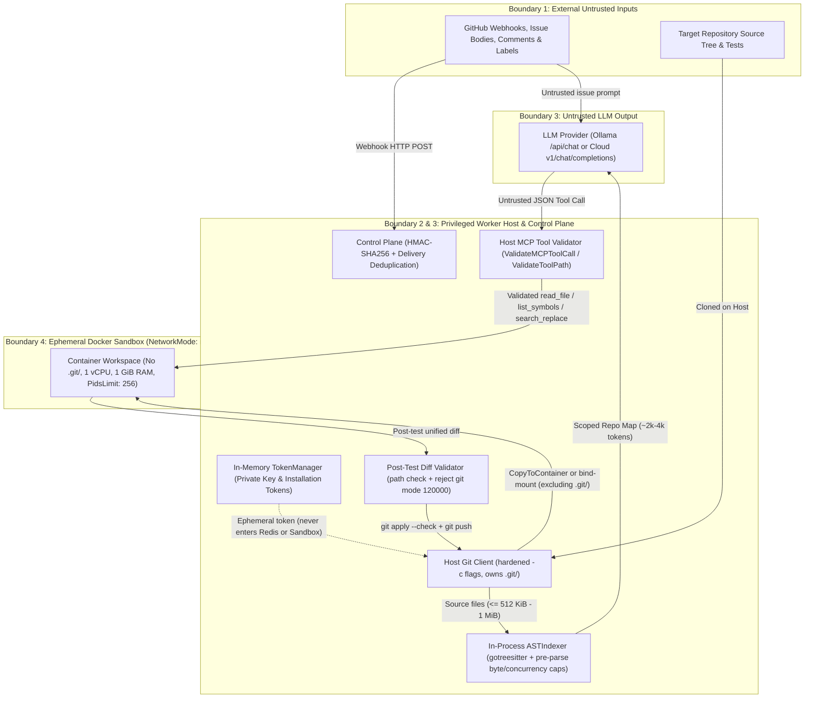

# Security & Threat Model

**Status:** Accepted (Phase 0 Verified)
**Date:** 2026-11-25

> [!NOTE]
> Every threat vector, isolation boundary, and mitigation in this document is backed by empirical evidence from [Spike 001](./spikes/001-docker-network-isolation.md), [Spike 002](./spikes/002-treesitter-go-bindings.md), and [Spike 003](./spikes/003-ollama-tool-calling.md) (synthesized in [Spike Learnings](./spikes/learnings.md)) or explicitly tracked as a Phase 1/2 production test gate.

---

## 1. Protected Assets

- **GitHub App Credentials & Installation Tokens ([ADR-005](./adr/005-github-app-token-manager.md)):** The GitHub App PEM private key and short-lived (`1-hour` TTL) Installation Access Tokens cached in Worker Host process memory (`TokenManager`). Compromise would allow unauthorized pushes or Pull Request creation across installed repositories.
- **Worker Host Filesystem, Privileged `.git/` Clone & Docker Socket ([ADR-002](./adr/002-docker-sdk-sandbox.md)):** The host directory holding the authenticated repository `.git/` metadata, the Worker Host OS environment, and the local Docker Engine socket (`npipe:////./pipe/docker_engine` on Windows; `unix:///var/run/docker.sock` on Linux).
- **Control Plane Infrastructure & Credentials ([ADR-001](./adr/001-go-control-plane.md)):** PostgreSQL state/audit store (`sqlc` + `pgx`), Redis Streams (`graft:jobs`) and Pub/Sub (`graft:telemetry`), webhook `HMAC-SHA256` signing secret, and cloud LLM API keys.
- **Worker Host Compute, Memory & GPU VRAM ([ADR-002](./adr/002-docker-sdk-sandbox.md), [ADR-003](./adr/003-treesitter-and-mcp.md), [ADR-004](./adr/004-llm-provider-abstraction.md)):** Host RAM (shared by the in-process pure-Go `gotreesitter` AST indexer), sandbox cgroup allocations (`1 vCPU`, `1 GiB RAM`, `PidsLimit: 256`), and local GPU VRAM (`8.0 GiB` reference budget for local Ollama inference).
- **Target Repository Integrity ([ADR-002](./adr/002-docker-sdk-sandbox.md), [ADR-003](./adr/003-treesitter-and-mcp.md)):** CI/CD workflow definitions (`.github/workflows/*`), Git hooks (`.git/hooks/*`), repository configuration (`.git/config`), and secret files (`.env*`, `*.pem`, `*.key`, `*.crt`).

---

## 2. Trust Boundaries

1. **Boundary 1 — External GitHub Webhooks & Issues → Control Plane & Agent Prompt:** GitHub webhook payloads, issue titles/descriptions, user comments, and CI logs are untrusted external inputs that may be forged, replayed, triggered from untrusted forks, or crafted with indirect prompt injections.
2. **Boundary 2 — Target Repository Files → Worker Host AST Indexer (`ASTIndexer`):** Target repository source code is parsed in-process on the privileged Worker Host via pure-Go `gotreesitter` ([ADR-003](./adr/003-treesitter-and-mcp.md)) before container execution. Malformed or oversized files (e.g., multi-megabyte minified bundles) cross into Worker Host memory during AST indexing.
3. **Boundary 3 — Untrusted LLM Outputs → Host MCP Tool & Diff Validators:** All LLM responses and tool-call JSON payloads (`read_file`, `list_symbols`, `search_replace`) are treated as untrusted inputs capable of attempting path traversal, symlink escape, oversized payload DoS, or unauthorized writes to protected paths.
4. **Boundary 4 — Privileged Worker Host → Ephemeral Docker Sandbox (`NetworkMode: "none"`):** Candidate patches and repository unit tests execute untrusted arbitrary code inside an ephemeral container. The container must never access the network, Worker Host credentials, the privileged host `.git/` directory, or unbounded host CPU/RAM/PID/diff-output resources.

---

## 3. Threat Matrix

| ID | Attack Vector / Failure Mode | Target Asset | Technical Mitigation | Verification Evidence (Spike / Automated Test) |
| :--- | :--- | :--- | :--- | :--- |
| **T-01** | **Sandbox Outbound Exfiltration or Callback:** Malicious repository test code or prompt-injected payload attempts to exfiltrate source code or contact an external C2 over HTTP/DNS. | Target Repository Source & Worker Host Network | Create every execution sandbox with `NetworkMode: "none"` from container creation (`lo` loopback interface only; zero external NICs, default routes, or DNS resolvers). All `git clone`/`git push` run on the Worker Host. Optional `:ro` dependency caches are pre-populated in a separate credential-less preparer container before starting the `NetworkMode: "none"` sandbox ([ADR-002](./adr/002-docker-sdk-sandbox.md)). | **Verified ([Spike 001](./spikes/001-docker-network-isolation.md)):** `36/36` offline runs blocked outbound HTTP (`curl` exit `6`) and DNS (`nslookup` exit `1`); `ip addr` confirmed `lo` only (`347ms` med / `379ms` P95 lifecycle overhead). Phase 1 integration test: `TestSandboxNetworkIsolation`. |
| **T-02** | **Host RCE via `.git/hooks/` or `.git/config` Poisoning:** Untrusted code or LLM edits inside the sandbox modify `.git/hooks/*` or `.git/config` (`core.fsmonitor`, `core.sshCommand`) so that subsequent host-side `git diff`/`git push` executes attacker binaries on the Worker Host. | Worker Host OS & GitHub App Tokens | Never expose the host `.git/` directory writable inside the sandbox on either transport path (excluded from `CopyToContainer` TAR streams and kept outside the sandbox mount on Linux bind-mounts). Execute every host-side Git command with `-c core.autocrlf=false -c core.hooksPath=/dev/null -c core.fsmonitor=false -c submodule.recurse=false` ([ADR-002](./adr/002-docker-sdk-sandbox.md)). | **Verified ([Spike 001](./spikes/001-docker-network-isolation.md), [Spike 003](./spikes/003-ollama-tool-calling.md)):** Windows `CopyToContainer` flow transferred `1,410` files excluding host `.git/` and initialized an isolated container-local baseline (`737ms`). Host MCP `ValidateToolPath` blocked `.git/hooks/pre-commit` live (`E4`) and `.git/config` / `.git/hooks/pre-commit` in `25/25` unit tests. |
| **T-03** | **Credential Leakage into Sandbox Env, Redis Queue, SSE Telemetry, or GitHub Comments:** GitHub App private keys, installation tokens, PostgreSQL DSNs, LLM API keys, or test-output secrets leak into container env vars, `.git/config`, Redis job payloads, SSE streams, or GitHub failure comments. | GitHub App Tokens, Control Plane & Repo Secrets | `TokenManager` ([ADR-005](./adr/005-github-app-token-manager.md)) generates short-lived (`1h`) tokens in Worker memory (`singleflight`, `< 5m` proactive refresh) using only `installation_id` from Redis; tokens never enter `.git/config` or `Config.Env`. Sandbox/test logs are size-truncated and scrubbed of credential patterns (`ghp_`, `ghs_`, `github_pat_`, `sk-`, PEM blocks) before publishing to `graft:telemetry` or GitHub comments. | **Verified ([Spike 001](./spikes/001-docker-network-isolation.md)) & Design Adopted ([ADR-005](./adr/005-github-app-token-manager.md)):** Sandbox containers run with empty credential env. Phase 1/2 unit tests: `TestTokenManagerConcurrency` (`go test -race`), `TestSandboxZeroSecretEnv`, and `TestLogSecretRedaction`. |
| **T-04** | **Indirect Prompt Injection via Issue Body or Source Comments:** An issue description or source file instructs the LLM to read `.env` secrets, exfiltrate keys, or overwrite `.github/workflows/ci.yml` to gain CI execution privileges. | Repository Secrets (`.env*`, `*.pem`, `*.key`) & CI Workflows (`.github/*`) | Treat LLM tool calls as untrusted. Enforce deterministic host-side `ValidateMCPToolCall` / `ValidateToolPath` before executing any tool ([ADR-003](./adr/003-treesitter-and-mcp.md)): block all reads/writes to `.git/`, `.env` and `.env.*` (allowing only `.env.example`, `.env.sample`, `.env.template`), and `*.pem`/`*.key`/`*.crt`; allow `.github/` reads (`isWrite=false`) for CI failure diagnosis while blocking all `.github/` writes (`isWrite=true`). | **Verified ([Spike 003](./spikes/003-ollama-tool-calling.md)):** Both `qwen2.5-coder:7b` and `14B` obeyed `8/8` (`100%`) indirect prompt injections (`E1`–`E4`), proving prompt rules alone are insufficient; host `ValidateMCPToolCall` intercepted and blocked `8/8` (`100%`, `0` bytes leaked or modified) and returned structured rejection errors (`4/4` Turn-2 recovery on `E1`/`E2`). |
| **T-05** | **Path Traversal, Diff-Header Spoofing & Symlink/Junction Escape:** LLM tool arguments use `../`, absolute paths, Windows volume/UNC paths, unified diff headers (`--- a/`, `+++ b/`) pointing outside the target path, or in-workspace symlinks/NTFS junctions (`mklink /J`) to escape the workspace root. | Worker Host Filesystem & Protected Repository Paths | Normalize paths with `filepath.Clean` + `filepath.Rel`, walk every existing path segment from workspace root downward via `os.Lstat` (`ModeSymlink != 0`) + `os.Readlink` before `filepath.EvalSymlinks`, inspect all `--- a/` and `+++ b/` headers inside unified diffs, and re-validate final sandbox-to-host diffs while rejecting Git symlink mode `120000` ([ADR-003](./adr/003-treesitter-and-mcp.md)). | **Verified ([Spike 003](./spikes/003-ollama-tool-calling.md)):** `25/25` unit tests (`go test -v`, `1.083s`) passed, including `../` traversal, `/etc/passwd`, `C:\Windows\System32`, diff-header spoofing to `.github/workflows/pwn.yml`, and live Windows NTFS directory junction (`mklink /J`) escape (`TestSymlinkOrJunctionEscapeBlocked`). |
| **T-06** | **Worker Host OOM / DoS via Oversized or Malformed Source Files During AST Indexing:** Because `gotreesitter` runs on the Worker Host ([ADR-003](./adr/003-treesitter-and-mcp.md)), a multi-megabyte minified file or deeply nested syntax tree triggers huge pre-parse slice allocations before internal parser checks run. | Worker Host RAM & Availability | Pure-Go `gotreesitter` eliminates C-heap segfaults (`CGO_ENABLED=0`). Enforce a **primary pre-parse per-file byte limit (`512 KiB`–`1 MiB`)** and bounded worker concurrency before calling `parser.Parse`, backed by **secondary** `SetTimeoutMicros` + `SetMemoryBudgetBytes` (`ParseStrict`), `tree.RootNode() == nil` check, and pre-`Release()` symbol value extraction ([ADR-003](./adr/003-treesitter-and-mcp.md)). | **Verified ([Spike 002](./spikes/002-treesitter-go-bindings.md)):** Without a pre-parse byte cap, `minified_2mb.ts` (`2.85 MiB`) pre-allocated `165`–`171 MiB` `HeapInuse` (`110`–`123 MiB` Peak RSS) in `22.44ms` under a `1ms` timeout and `296.68 MiB` RSS under a `64 MiB` arena budget (`260.64 MiB` `VmHWM` in a `1 GiB` Linux container). Pre-parse file size rejection prevents allocation completely. |
| **T-07** | **MCP Payload / File Read Memory Exhaustion:** LLM requests `read_file` on a large binary/bundle inside the repository or emits a multi-megabyte JSON tool argument envelope. | Worker Host & Agent Loop Memory | Enforce a strict `256 KiB` (`262,144 B`) byte cap on raw MCP JSON tool arguments and target file sizes (`os.Lstat` pre-read check) before loading file contents into memory ([ADR-003](./adr/003-treesitter-and-mcp.md)). | **Verified ([Spike 003](./spikes/003-ollama-tool-calling.md)):** `E6` (`E6_size_caps`) rejected a `1.0 MiB` (`1,048,576 B`) file read in `2,701 µs` (`0` bytes read) and a `257 KiB` (`263,316 B`) MCP JSON envelope in `525 µs`. |
| **T-08** | **Sandbox Resource Exhaustion, Fork Bomb, Diff Bomb, or Hung Process:** Malicious or broken test suite spawns a fork bomb, allocates unbounded RAM, writes huge diffs, or hangs indefinitely inside the container or LLM call. | Worker Host CPU, RAM, Disk, PID Table & Worker Throughput | Enforce cgroups v2 limits (`1 vCPU`, `1 GiB RAM`, `PidsLimit: 256`), cap extracted unified diffs at `≤ 1 MiB`, wrap container execs and LLM HTTP calls in `context.WithTimeout`, and unconditionally execute `ContainerRemove(Force: true, RemoveVolumes: true)` on a fresh cleanup context when a timeout fires, backed by a `> 2m` stale-heartbeat reaper and `max_job_timeout` (`10m` cloud / `20m` local) ([ADR-001](./adr/001-go-control-plane.md), [ADR-002](./adr/002-docker-sdk-sandbox.md)). | **Verified ([Spike 001](./spikes/001-docker-network-isolation.md), [Spike 003](./spikes/003-ollama-tool-calling.md)):** Verified cgroups v2 limits, forced `ContainerRemove` (`49ms` on timed-out `sleep 60`, `0` orphans vs. `ExecAttach` cancel leaving `PID=3961` running), and `E5` LLM HTTP timeout (`250ms`–`251ms` clean abort, `HTTP 499`). |
| **T-09** | **Silent Context Truncation Dropping System Guardrails or File Context:** Local Ollama silently truncates prompts when `/v1/chat/completions` ignores `num_ctx` (defaulting to `4096` on `8 GiB` VRAM GPUs and truncating to `limit=2050` with `HTTP 200`), dropping security instructions or code context. | Agent Patch Accuracy & System Prompt Integrity | Route Ollama calls through native `/api/chat` with explicit `options.num_ctx` (`8192` or `16384`), verify active window via `/api/ps` (`context_length`) or `OLLAMA_NUM_PARALLEL=1`, and audit returned `prompt_eval_count` against pre-request estimated input tokens (`bytes/4` + tokenizer margin), failing fast if `prompt_eval_count` drops significantly below the estimate ([ADR-004](./adr/004-llm-provider-abstraction.md)). | **Verified ([Spike 003](./spikes/003-ollama-tool-calling.md)):** Captured `llama-server` log `truncating input prompt limit=2050 prompt=7312` (`prompt_tokens=2050`, `HTTP 200`) on `/v1/chat/completions`, and verified that `/api/chat` with `options.num_ctx=8192` allocated `n_ctx=8192` and evaluated all `7,312` tokens (`prompt_eval_count=7312`). |
| **T-10** | **Linux Docker Socket Privilege Escalation & Bind-Mount UID Mismatch:** Non-root worker process fails to connect to `0660 root:root` `/var/run/docker.sock` or creates root-owned files in bind-mounted workspaces. | Worker Host Privilege Boundary | Run Linux workers with socket GID alignment (`--group-add <docker-gid>`) or behind a read/write-scoped Docker socket proxy, and set container `Config.User` to match the worker's `uid:gid` whenever bind-mounts are used ([ADR-002](./adr/002-docker-sdk-sandbox.md)). | **Verified ([Spike 001](./spikes/001-docker-network-isolation.md)):** Verified `unix:///var/run/docker.sock` (`0660 root:root`, `6.183ms` Ping) and reproduced `permission denied` as UID/GID `1000:1000` without socket GID alignment. |
| **T-11** | **Spoofed, Replayed, or Untrusted-Fork GitHub Webhooks:** Unauthenticated caller sends forged/replayed webhook payloads, or an attacker opens a Pull Request from an external fork on a public repository to trigger `workflow_run` sandbox/LLM execution. | Control Plane Job Queue, Compute Budget & Repository Integrity | Verify `X-Hub-Signature-256` using constant-time `hmac.Equal` (`HMAC-SHA256`) before parsing payload bodies, enforce a PostgreSQL `UNIQUE` constraint on `X-GitHub-Delivery` UUIDs, and reject `workflow_run` events where `head_repository.id != base_repository.id` before enqueueing to `graft:jobs` ([ADR-001](./adr/001-go-control-plane.md)). | **Design Adopted ([ADR-001](./adr/001-go-control-plane.md)):** Verified in Phase 1 via unit and integration tests (`TestWebhookHMACVerification`, `TestWebhookDeliveryDeduplication`, `TestWebhookForkWorkflowRejected`). |

---

## 4. Resolved Security Architecture Questions

1. **Docker Network Lifecycle ([Spike 001](./spikes/001-docker-network-isolation.md), [ADR-002](./adr/002-docker-sdk-sandbox.md)):**
   - *Decision:* Sandboxes launch with `HostConfig.NetworkMode = "none"` from container creation rather than toggling `NetworkDisconnect` mid-flight. Host-side Git performs all repository cloning and pushing, eliminating any window where a sandbox container has both network access and repository code. If a repository requires pre-warmed toolchain caches, a separate credential-less preparer container populates a host volume that is mounted `:ro` into the `NetworkMode: "none"` execution sandbox.
2. **AST Parsing Trust Boundary & Memory Safety ([Spike 002](./spikes/002-treesitter-go-bindings.md), [ADR-003](./adr/003-treesitter-and-mcp.md)):**
   - *Decision:* AST indexing runs in-process on the Worker Host using pure-Go `github.com/odvcencio/gotreesitter v0.58.0` (`CGO_ENABLED=0`), eliminating C FFI memory-corruption risks. Because `gotreesitter` pre-allocates token/node arenas before checking `SetTimeoutMicros` or `SetMemoryBudgetBytes`, the Worker Host enforces a mandatory **pre-parse per-file byte limit (`512 KiB`–`1 MiB`)** and bounded concurrent parser workers as the primary OOM defense, with `ParseStrict` timeout/arena budgets as secondary defense-in-depth.
3. **MCP Tool Path & Diff Sanitization ([Spike 003](./spikes/003-ollama-tool-calling.md), [ADR-003](./adr/003-treesitter-and-mcp.md)):**
   - *Decision:* All MCP tool calls (`read_file`, `list_symbols`, `search_replace`) pass through deterministic host-side validation (`ValidateMCPToolCall` / `ValidateToolPath`) enforcing a `256 KiB` argument/file cap, workspace containment, per-segment `os.Lstat` + `os.Readlink` + `filepath.EvalSymlinks` symlink/junction checks, read-only `.github/` access (`isWrite=false` allowed; `isWrite=true` blocked), and unconditional blocks on `.git/`, `.env*` (except `.env.example`/`.sample`/`.template`), and `*.pem`/`*.key`/`*.crt`. Post-test diff extraction from the sandbox re-validates all `--- a/` and `+++ b/` headers and rejects Git symlink mode `120000` before applying changes to the host clone.

---

## 5. Verification Evidence Checklist

- [x] **Sandbox network isolation test ([Spike 001](./spikes/001-docker-network-isolation.md)):** Verified `0` outbound packets and `lo`-only interface under `NetworkMode: "none"` across `36/36` HTTP (`curl` exit `6`) and DNS (`nslookup` exit `1`) probe runs.
- [x] **Sandbox cgroup & forced teardown test ([Spike 001](./spikes/001-docker-network-isolation.md)):** Verified cgroups v2 enforcement (`1 vCPU`, `1 GiB RAM`, `PidsLimit: 256`) and proved `ContainerRemove(Force: true, RemoveVolumes: true)` terminates timed-out exec processes (`sleep 60`) in `49ms` (`n=1` timeout probe) / `68ms`–`163ms` median with `0` orphan containers.
- [x] **Worker Host AST memory & timeout safety ([Spike 002](./spikes/002-treesitter-go-bindings.md)):** Benchmarking across `40` to `1,042` source files (`30.31 MiB`–`74.84 MiB` Linux `VmHWM`) and adversarial `2.85 MiB` minified inputs proved the necessity and effectiveness of the pre-parse `512 KiB`–`1 MiB` file byte cap combined with `gotreesitter` timeout and arena budgets.
- [x] **Path traversal, symlink/junction & restricted-path rejection tests ([Spike 003](./spikes/003-ollama-tool-calling.md)):** Verified across `25/25` unit tests (`1.083s`) and `8/8` live indirect prompt-injection runs (`E1`–`E4` on `qwen2.5-coder:7b` and `14B`), blocking `../`, absolute paths, Windows NTFS junctions (`mklink /J`), `.git/`, `.env*`, `*.pem`/`*.key`/`*.crt`, `.github/` writes, and `> 256 KiB` files/payloads.
- [x] **Zero-secret sandbox & in-memory token lifecycle architecture ([Spike 001](./spikes/001-docker-network-isolation.md), [ADR-002](./adr/002-docker-sdk-sandbox.md), [ADR-005](./adr/005-github-app-token-manager.md)):** Host-side Git owns `.git/` and transient Installation Access Tokens; sandbox containers receive zero credentials in `Config.Env` or filesystem mounts (automated regression tests `TestTokenManagerConcurrency` and `TestSandboxZeroSecretEnv` scheduled for Phase 1 implementation).
